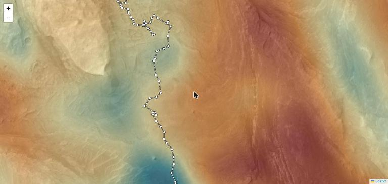

# Marswalk

A field map for one Marswalk (EVA) at the Mount Sharp boxwork in Gale crater, built for the
NASA Space Apps 2026 challenge "Interplanetary Survival Guide: Martian Map".

It shows a layered NASA map of the site, a pointer for where the walker (astronaut or robot) is
and which way they are looking, and a trail that remembers every pass over the same ground in order.
Trails can be recorded per walker, saved, replayed and shared as files. Named landmarks can be tapped
for their details and outline, and the look and controls are adjustable in Settings.
You can put your own markers anywhere on the planet, and ask for the ways to any point: each route gets
a safety index and the reasons for it, or a plain statement of why no route is viable.



## Run it

- **Quickest:** open `marswalk.html` in Chrome, Edge or Firefox. It is the whole app in one file.
- **From source:** open `index.html`, or serve the folder with `python -m http.server` and open
  `http://localhost:8000`.
- **GitHub Pages:** enable Pages on the main branch. There is no build step.

The map imagery streams from NASA's Mars Trek tile server, so the browser needs internet access.
If the tiles cannot be reached the page says so; the route, pointer and trail still work.

## Where things live

Plain JavaScript, no framework and no build step. Each file adds to one global object, `MW`,
and they load in this order (see the bottom of `index.html`). In this flat checkout every file sits
beside `index.html`; the `js/`, `css/` and `tools/` prefixes below are where each goes in a foldered checkout.

| File | What it holds | Edit it when you want to… |
|---|---|---|
| `js/config.js` | Every constant, colour ramp and map layer | add or change a layer, tune the trail, change walking speed |
| `js/data.js` | The NASA data pack: Curiosity's route, REMS weather, Navcam photo ids | move to another site or refresh the data |
| `js/geo.js` | Unpacks `data.js`; coordinate conversion; number and text formatting | change the coordinate model |
| `js/tiles.js` | `MW.SmoothTiles`: the tile layer (over-zoom, recolouring, reading values) | change how tiles are drawn or sampled |
| `js/trail.js` | `MW.Trail`: trail points, pass counting, way back, saved-trail format | change what counts as "the same ground" |
| `js/store.js` | `MW.store`: saved trails in the browser's storage | keep trails somewhere else (a server, a suit computer) |
| `js/markers.js` | `MW.markers`: the user's markers, the four built-in icons, uploaded icons, the filter | change what a marker holds or how an icon is drawn |
| `js/landmarks.js` | `MW.landmarks`: named places, their outlines, the rules for showing names | add a landmark or change when names appear |
| `js/ui.js` | `MW.ui`: the line icons on buttons and their hover labels | add a button icon |
| `js/settings.js` | `MW.settings`: the user's choices and the Settings panel | add a setting |
| `js/app.js` | The page: map, pointer, movement, recording, readouts, main loop | change behaviour or the interface |
| `js/trail-edit.js` | `MW.trailEdit`: the on-map editor for the trail walked so far | change how a trail is edited |
| `js/dust-data.js` | The dust data pack: observed dust optical depth, MY24 to MY36 (written by `tools/dust_ingest.py`) | never by hand: rebuild it |
| `js/dust.js` | `MW.dust`: seasonal baseline, anomaly detection, classes, route exposure. No map, no page | change how dust activity is detected |
| `js/dust-ui.js` | The DUST STORM ACTIVITY layer, timeline, dust monitor and route warnings | change how dust is shown |
| `js/terrain-data.js` | The terrain pack: height above the MOLA reference level, whole planet (written by `tools/terrain_ingest.py`) | never by hand: rebuild it |
| `js/terrain.js` | `MW.terrain`: height and regional slope at any point. No map, no page | change how height is read |
| `js/router.js` | `MW.router`: the route-finder and the safety index. No map, no page | change how routes are found or scored |
| `js/nav-ui.js` | The Markers and routes tab: marker form, icon picker, filter, route search, result cards, lines on the map | change how markers and routes are shown |
| `tools/terrain_ingest.py` | Builds `js/terrain-data.js` from the MarsTopo719 shape model and the GMM-3 gravity model | change the terrain resolution |
| `tools/router_test.js` | Checks the terrain pack and the route-finder against the real data: `node tools/router_test.js` | you changed `router.js`, `terrain.js` or a limit |
| `tools/dust_ingest.py` | Downloads the dust climatology and writes `js/dust-data.js` | refresh the data, or change its resolution |
| `tools/dust_test.js` | Checks the detection against the real data: `node tools/dust_test.js` | you changed `dust.js` or a threshold |
| `css/style.css` | All styling | change the look |
| `tools/build.py` | Packs everything into `dist/marswalk.html` | you changed any file above: run `python tools/build.py` |
| `vendor/` | Leaflet 1.9.4, unmodified | – |

`js/app.js` is divided into eight numbered sections listed at its top. `trail.js` and `store.js`
do not touch the map or the page, so they can be reused or tested on their own.
Choices offered in Settings (trail palettes, pointer colours, themes, display and movement modes,
default walkers) are plain lists in `js/config.js`; theme colours are the `body[data-theme]` blocks
at the top of `css/style.css`.

### Common changes

**Add a map layer.** Find the layer on the
[Trek layer list](https://trek.nasa.gov/tiles/apidoc/trekAPI.html?body=mars), then add one entry
to `LAYERS` in `js/config.js`:

```js
{ key: 'my-layer', name: 'Name in the list', id: 'Trek_Layer_Name', ext: 'png', nz: 9, res: '100 m',
  read: 'grey', ramp: 'heat', stretch: true, ends: ['cooler', 'warmer'], what: 'ground warmth',
  note: 'One or two sentences on what the layer shows and how to read it.' }
```

`nz` is the deepest zoom the server really has: request
`{TREK}{id}/1.0.0/default/default028mm/{z}/{y}/{x}.{ext}` at rising `z` until it returns 404.
The fields `read`, `ramp`, `stretch`, `legend`, `ends` and `what` are explained above `LAYERS`.
The legend bar, the readout under the map and the tick on the bar all follow from the entry.

**Add a landmark.** Add one entry to `LIST` in `js/landmarks.js`; the comment at the top of that
file explains each field. Its name, outline, popup and visit counts follow from the entry.

**Add a colour theme.** Add a `body[data-theme="name"]` block in `css/style.css` and the name to
`THEMES` in `js/config.js`.

**Feed a real position.** Call this from any script, as often as fixes arrive:

```js
Marswalk.setPose({ lat: -4.8012, lon: 137.3829, heading: 215 });   // heading: degrees clockwise from north
Marswalk.releasePose();                                            // hand control back to the page
```

**Move to another site.** Replace the three strings in `js/data.js` (the comment at its top gives
each source and encoding) and the `BASE` layers and bounds in `js/config.js`.

## What is on the map

| Kind | Layer | Source (Trek layer id) | Deepest real zoom | Ground per pixel |
|---|---|---|---|---|
| Optical | Photo base | MRO HiRISE `curiosity_hirise_mosaic` | 16 | 0.6 m |
| Optical | Photo base, surroundings | MRO CTX `Gale_CTX_BlockAdj_dd` | 12 | 10 m |
| Optical | Photo base, planet | Viking `Mars_Viking_MDIM21_ClrMosaic_global_232m` | 7 | 325 m |
| Thermal | Daytime and night infrared | Odyssey THEMIS `THEMIS_DayIR/NightIR_ControlledMosaics_100m_v2_oct2018` | 9 | 100 m |
| Topographic | Colour elevation, shaded relief | MOLA + HRSC `Mars_MOLA_blend200ppx_HRSC_*` | 8 | 200 m |
| Spectral, chemical | Clinopyroxene, plagioclase, glass and clay, albedo | MGS TES `TES_*` | 1 | regional |
| Geophysical | Thermal inertia, dust cover, roughness | MGS TES, MGS MOLA | 1 | regional |
| Atmospheric | Air and ground temperature, pressure, UV at every route stop | Curiosity REMS | per sol | in place |
| Atmospheric | Dust storm activity: column dust optical depth | Montabone et al. climatology v2 (MGS TES, Odyssey THEMIS, MRO MCS) | 5-sol means, MY24–36 | 6° × 5° (about 355 × 296 km) |
| Topographic | Height and regional slope for the route-finder | MarsTopo719 shape model (MGS MOLA) on the GMM-3 areoid | 0.25° planet, 0.0625° Gale | about 15 km |
| Radiation | Dose rate and dose for this walk | Model on the RAD surface average, 0.67 mSv/day | modelled | – |
| Point of view | Navcam photo at every third stop | Curiosity raw images | per stop | – |

The reference route is Curiosity's real drive: 120 end-of-drive positions from sol 4560 to 5073,
2.9 km long with 175 m of climb. Base (0, 0) is the first of them.

## How the readings work, and what they are not

Every data layer has the same legend bar: a low word, the colours, a high word, and a tick at the
walker's own value. The same value is shown as a number under the map.

- **Thermal layers** are greyscale pictures. The page stretches the grey range inside the current
  view across a blue-to-red ramp. The number is *relative to the view*: 0 is the coolest ground in
  view, 100 the warmest. The THEMIS mosaics are normalised, so they do not carry kelvin.
- **Mineral, thermal-inertia and dust layers** come from Trek already painted in a rainbow. The page
  reads the hue back into a number (violet 0, red 100) and repaints it on one pale-to-deep ramp, so
  deeper always means more. The scale is fixed. The direction was checked against known regions
  (dusty Arabia reads high dust and low thermal inertia; Syrtis Major reads high pyroxene and
  plagioclase). The number is a position on NASA's colour scale, not a physical unit: Trek does
  not publish the unit range of these colour scales.
- **Albedo** is a greyscale picture on the same fixed pale-to-deep ramp.
- **Roughness** is NASA's three-channel composite; the readout gives the three channels.
- **Colour elevation** keeps NASA's colours; the readout gives the surveyed height in metres.
- **Weather** numbers are Curiosity's measured daily low and high; the hour-by-hour curve between
  them, and all radiation figures, are models and are labelled so on the page.

To get physical units for the regional layers, the next step is to download the numeric TES grids
from the PDS and sample those instead of the pictures.

## Dust storm activity

A detection and early-warning layer built on real orbital observations. It reports what was observed
and how unusual it was for the place and season. **It does not forecast.**

### The data

Column dust optical depth, in infrared absorption at 9.3 µm, normalised to 610 Pa, from
[Montabone et al., Climatologies of the Martian Atmospheric Dust Optical Depth, v2](https://www-mars.lmd.jussieu.fr/mars/dust_climatology/index.html)
(Icarus 2015, doi:10.1016/j.icarus.2014.12.034; JGR Planets 2020, doi:10.1029/2019JE006111; CC BY-SA 3.0).
The climatology is built from NASA retrievals: MGS TES, Mars Odyssey THEMIS and MRO
[Mars Climate Sounder](https://pdsatmospheres.nmsu.edu/data_and_services/atmospheres_data/MARS/aerosols.html).
From MY34 on it is MCS alone.

`python tools/dust_ingest.py` reads the NetCDF files straight from the server (only the variables it needs,
no extra packages), averages them to 6° × 5° cells and 5-sol frames, and writes `js/dust-data.js`:
13 Martian Years, 134 frames a year, 2,160 cells. For every cell and frame it keeps the optical depth,
its relative uncertainty, the data set's reliability value, the Ls, the sol and the instruments.
`--years 34 35` builds a subset; `--inspect 34` lists what is in a year's files.

Every number on the page carries one of four labels:

| Label | Meaning here |
|---|---|
| OBSERVED | a cell of the observation-only maps (`griddedcdod`) for those sols |
| HISTORICAL | statistics of OBSERVED values from the other Martian Years: the seasonal baseline |
| INTERPOLATED | the kriged complete-coverage maps (`dustscenario`), used only where there is no observation, only when an observation exists within 10 sols or in a neighbouring cell, and drawn on the map only if "Fill gaps" is ticked |
| MODELLED | not used: no dust value is a model output |

A cell with neither is NO DATA. It is drawn grey and is never treated as clear air.

### The detection (`js/dust.js`, thresholds in `DUST` in `js/config.js`)

1. **Baseline.** For each cell and season: every OBSERVED value within ±10° of Ls, from every Martian Year
   except the one being judged. This gives a median, a 90th percentile and a robust spread
   (1.4826 × the median absolute deviation, never less than 15 % of the median or 0.02).
   It needs 6 values from 3 other years.
2. **Anomaly.** z = (optical depth − median) ÷ spread; deviation = (optical depth − median) ÷ median.
3. **Persistence.** How many consecutive observed frames, ending at this one, were elevated.
4. **Region.** How many of the 8 neighbouring cells are elevated in the same frame.
5. **Trend.** A straight-line fit through the last 4 frames (20 sols): increasing, decreasing or stable
   (a change of at least 20 % of the mean and 0.03).
6. **Class.**

| Class | Criteria |
|---|---|
| LOW | not elevated: inside the normal range for the place and season |
| MODERATE | z ≥ 2 and optical depth ≥ 0.15. An elevated value that is neither persistent nor regional stays here, however high |
| HIGH | z ≥ 4 and optical depth ≥ 0.30, and persistent (2 frames, 10 sols) or regional (3 neighbours) |
| SEVERE | z ≥ 6 and optical depth ≥ 0.80, and persistent and regional |

The optical-depth floors are this project's own choices, not a published standard. Without a usable
baseline only the floors apply, the class is capped at HIGH and confidence is low. Confidence also drops
for interpolated values, retrieval uncertainty above 30 %, a baseline from fewer than 5 years, and
latitudes beyond 60°, where retrievals near the polar caps are less reliable.

A **storm event** is a run of frames in which HIGH or SEVERE cells cover at least 2 % of the observed
area between 60° S and 60° N. Run on the record, the detection finds the planet-encircling storms of
MY25, MY28 and MY34 without being told about them.

### On the page

- **Layer.** "DUST STORM ACTIVITY" in the legend column can be shown over any other layer. It is drawn as
  one rectangle per cell at the cell's true size. Colour it by optical depth, deviation from baseline,
  class or trend. A white line marks the edge of the HIGH or SEVERE region; a red triangle marks a rising cell.
- **Timeline.** Choose a Martian Year and an Ls range, step or play through the frames, replay a detected
  storm event, and compare with a second year (chart, monitor row, and a button to swap the years on the map).
- **Dust monitor.** For the walker's cell, or a cell tapped at Crater or Planet scale: optical depth,
  baseline, deviation, class, trend, regional activity, observation date, instrument, resolution,
  confidence, and how often this season was HIGH or SEVERE in the record.
- **Route.** The route being replayed is cut into sections, one per data cell, each with its class,
  measurements and the reasons. Elevated sections are highlighted on the map, with possible
  consequences: reduced visibility, harder surface operations, less solar power, timing to reassess.
  The astronaut strip shows the class at the walker's position; HIGH or SEVERE on the route raises a
  short notice on the map.

`MW.dustUI.goTo(34, 205)` jumps to a year and Ls; `MW.dustUI.show(true)` turns the layer on.

### What it is not

- Not a forecast, and not live: the newest observation in the pack is MY36, Ls 359° (December 2022).
  The class shown is for the frame selected on the timeline.
- Not a visibility or surface measurement. Optical depth describes the whole air column from orbit.
- Not local. One cell is about 355 × 296 km at Gale, so a Marswalk sits inside one cell and the data
  cannot tell one part of a short route from another.
- Dust cannot tell two paths inside one cell apart, so "Alternatives" here compares the stored routes and
  gives the historically clearest season for the place. The route-finder (Markers and routes) compares paths
  on everything else and refuses a destination in a SEVERE storm.
- The Mars Climate Sounder profiles on the PDS are not read directly; they enter through the climatology.
- Before MY28 the record rests on TES and THEMIS, with sparser coverage (32 % of grid points in MY27).

## Walkers, display modes and settings

A **walker** is a named astronaut or robot (Settings, or the Walker list in the top bar). Each saved
trail carries its walker's name and kind, and landmark visits are counted for the active walker.
There is one pointer on the map at a time: the active walker's.

Three **display modes** show the same data for different users:

| Mode | For | What changes |
|---|---|---|
| Planner | planning in the habitat | everything is shown |
| Astronaut | a glance through a visor | the legend column becomes a drawer; large readouts (looking, walked, back to base, time, dose); larger buttons |
| Robot | a rover or its operator | exact latitude and longitude (6 decimals), metres to the centimetre, heading to 0.1° |

In Planner and Robot on a wide screen, the tab on the legend column's right edge folds the column
away to give the map the full width; the choice is kept in the browser (key `marswalk.collarHidden`).
Where the column is a drawer (Astronaut, or a narrow screen), "Menu" opens it and × or Escape closes it.

The column has five parts, chosen with the tabs on its edge: **Menu** (trail, saved routes, route
measurements; shown first), **Markers and routes** (your markers, the filter, the route-finder),
**Map Overlay** (the data layers), **Dust Storm** (the dust layer, monitor and
route warnings) and **Timeline** (Martian Year, Ls range, playback, storm events). A section belongs to a
part through its `data-tab` attribute in `index.html`; `Marswalk.setTab('dust')` switches from code.

Small **(i)** buttons beside technical terms open a short explanation: what the value is and its unit, why it
matters on a walk, and whether it is measured, historical, interpolated or modelled. The texts are
`GLOSSARY` in `js/config.js`; any `<button class="info" data-info="key">` opens the entry with that key.

**Layout** (Settings > Display) has three choices: the readouts in a row under the map, in a column beside
it, or **Numbers first, mini-map**: the readouts fill the main area as large cards, the live safety index
gets the largest card with all its factors, and the map becomes a mini-map in the top right corner with the
rover view and walk pad beneath it. The mini-map is the same map: it follows the walker and takes taps.

Nothing in that layout scrolls. `fitNumbers` in `js/app.js` tries 2 to 8 columns of cards and keeps the
largest type size at which every ticked readout is in view and no number is broken across lines, so the size
follows the window and how many readouts are ticked: with all sixteen on, values are about 32 px at 1440 × 900
and 46 px at 1920 × 1080; with three on, over 60 px. In a small window the factor list and the two headings
are dropped before the type falls under half size. In the side column the mini-map gives up height to the
notices (alarm, dust warning), and the rover view steps aside when under 120 px would be left for it. Below
about 1000 × 650 with everything on, the numbers get smaller than in the ordinary layout and that layout is
the better choice; under 861 px wide the page stacks (map on top, numbers beneath) and scrolls as a page.

**Settings** also change the trail's colour (five palettes, each four shades from pale to deep) and
width, the pointer's colour and size, how the pointer is moved (keys and taps, keys only, taps only)
and the app's colours (Blue, Night blue, Grey). Choices are kept in the browser
(`localStorage`, key `marswalk.settings.v1`).

## Landmarks

31 named places: the main features and landing sites of the planet, and the places Curiosity has
worked in Gale crater. Tapping a name shows its function, size, the missions that have visited,
the active walker's own visits (this trail plus their saved trails) and a note, and draws its outline.

Names follow map conventions: higher rank and larger places show first and in larger type; a name
disappears when its place is too small to matter at the current zoom or has grown larger than the
screen; names never overlap, the higher rank wins. The thresholds are at the top of the label code
in `js/landmarks.js`.

What the outlines are, and are not:

- Planet-scale features and Gale crater are circles or ellipses from the catalogued centre and size.
  They are approximate.
- The Gale places (Yellowknife Bay to Gediz Vallis) are the ground Curiosity actually covered there,
  computed from its position fixes (`MSL_waypoints.json`) with a 25 m margin. They are not geological
  boundaries, and the sol range attached to each name is approximate.
- "Visited by missions" counts surface missions, not individual drives or sols.

## The trail

A point is stored every 1.5 m with its time, odometer and look direction. A new pass over a spot
is counted when the walker comes within 2.5 m of earlier trail after walking at least 12 m away
from it. The line is drawn as four canvas strokes (once, twice, three times, four or more), so
drawing cost does not grow with the number of colours. Tapping the trail lists every pass in order.
"Show way back" draws the trail in reverse with every loop cut out.

**Record, save, edit.** "Record a new trail" is the labelled button under "Your trail"; that panel and
"Saved routes and trails" show in both the Menu tab and the Markers and routes tab. You do not have to press
Record first: the popup that opens when you tap the trail has **Save this trail** and **Edit this trail**,
and the same two actions are the first two icons under the Record button.

**Editing** (`js/trail-edit.js`) works on a thinned copy of the trail: the fewest points that stay within a
metre of the walked line. Drag a point to move it; tap a point to delete it, end the trail there or start
it there; tap the line to add a point; Undo, Done and Cancel are in the bar on the map. Done lays the trail
again along the edited line (a point every 1.5 m, pass counts worked out afresh, times at the pace walked so
far) and puts the walker at its end. The walker stands still while the editor is open.

**What a tap would lead to.** In "Walk it yourself", with taps allowed in Settings, the mouse carries a small
panel: every readout ticked in Settings > Display, worked out for the spot under the mouse and the moment you
would arrive there (position, height, bearing from you, distance and time on arrival, temperatures, dose,
dust class, map-layer value, safety index). It needs a mouse; touch screens do not have a hover.

### Saved trails

"Record a new trail" starts a fresh trail; "Stop and save" names and stores it in the browser
(`localStorage`, key `marswalk.trails.v1`). A saved trail can be shown on the map, replayed
(the pointer waits at its start until Start is pressed), downloaded and imported. The file is JSON:

```json
{ "format": "marswalk-trail", "version": 1, "id": "t…", "name": "Ridge loop",
  "savedAt": "2026-11-14T08:30:00.000Z", "source": "walked", "walker": { "name": "Astronaut 1", "type": "astronaut" },
  "site": "Mount Sharp boxwork, Gale crater, Mars", "base": { "lat": -4.799847, "lon": 137.383541 },
  "distance_m": 84.2, "duration_s": 157,
  "fields": ["lat", "lon", "seconds", "heading_deg"],
  "points": [[-4.8260233, 137.388886, 0, 188], …] }
```

## Markers and routes

The second tab on the column's edge. `Marswalk.openTab('nav')` opens it from code.

### Markers

Press **+** and tap the map, press the locate button to mark where the walker stands, or right-click
(long-press) the map. A marker can go anywhere on the planet. It holds a name, a description, an icon and
its position; the description takes a little Markdown (`**bold**`, `*italic*`, `` `code` ``, `- ` lists,
`[links](https://…)`), and anything else is shown as typed. Drag the pin to move it before saving.

| Icon | What the route-finder does with it |
|---|---|
| Pin (default) | nothing: a note or a destination |
| Home | counts as a base: "distance from the nearest base" and the way back are measured to it |
| Crater | nothing: a landform worth finding again |
| Danger | routes stay outside its keep-clear distance (50 m unless you set another), and pay for passing close |
| Your own | nothing. The **+** beside the four icons uploads a picture; it is shrunk to a 64 px PNG and kept for reuse (up to 12) |

**Show on the map** is the filter: one tick per icon kind, one for markers with your own icons, one for the
NASA place names, and an eye beside each marker in the list to hide just that one. Everything is on until
you untick it; "Show everything" puts it all back. Markers, icons and the filter are kept in the browser
(`localStorage`, keys `marswalk.markers.v1`, `marswalk.marker-icons.v1`, `marswalk.marker-filter.v1`).

### Finding a route

Type a marker or place name, or a latitude and longitude, in **Route to**; or press the target and tap the
map; or press "Route here" on a marker. Routes start where the active walker stands and are scored for that
walker (astronaut or robot), for the departure time in **Leave at**, and for the dust observed on the date
chosen on the Timeline.

If no route is viable the bar says so, with the reason:

| Reason | When |
|---|---|
| too far | the straight line is longer than the walker can cover at all (astronaut: 8 h at 1.2 m/s; robot: 30 sols of 6 h at 4 cm/s) |
| dust storm | the start or the destination is in a SEVERE storm |
| keep-clear distance | the destination is inside a danger marker's radius |
| hazard area | the destination is inside a landmark whose role is a hazard (Bagnold Dunes) |
| regional slope | the land at the destination is steeper than the limit (astronaut 18°, robot 22°) |
| closed ground | every way there crosses one of the above |
| out and back | the walk there plus the way back to the nearest base is longer than 8 h |
| climb | the way there climbs more than 1,500 m (astronaut) |

Otherwise the routes are listed safest first. Each card shows its **safety index** (0 to 100, higher is
safer), the travel distance, the time, up to three reasons it is safe and up to four reasons it is not, as
short tags. The first card is the recommendation. "Follow this route" makes it the route the pointer follows.

### The algorithm (`js/router.js`, every limit and weight in `ROUTER` in `js/config.js`)

1. **Grid.** The ground between the two points, with room either side, is cut into at most 120 × 120 cells.
   Each cell gets its height and regional slope from the terrain pack, is closed if it is too steep or inside
   a hazard, and is flagged if a known trail runs through it (Curiosity's drive, every saved trail, the
   trail being walked now).
2. **Search.** A* over that grid, up to five times, each with a different cost: *Balanced* (distance, slope,
   climb, hazard clearance, a discount on known ground), *Known ground* (a large discount on known ground),
   *Most direct* (distance only), *Alternative* (balanced, but kept away from the balanced route) and
   *Along your preferred trail* (a very large discount on the starred trail). Stair-steps are straightened
   where the straight line costs no more; routes that come out the same are merged.
3. **Measure.** Distance, climb, steepest regional slope, time (Naismith's rule for climb), the way back,
   farthest point from a base, daylight and temperature over the outing, dust class along the line, share on
   known ground, clearance from danger markers.
4. **Score.** Each measurement becomes a risk from 0 to 1:

| Factor | Risk is 0 at | Risk is 1 at (astronaut) | Weight, astronaut / robot |
|---|---|---|---|
| Dust | LOW | SEVERE (HIGH 0.85, MODERATE 0.45, no data 0.4; +0.1 if rising) | 0.20 / 0.24 |
| Regional slope | 6° | 18° | 0.12 / 0.20 |
| Climb | 0 m | 600 m | 0.08 / 0.08 |
| Distance from nearest base | 0 m | 5 km | 0.14 / 0.04 |
| Time, out and back | 0 h | 8 h | 0.14 / 0.18 |
| Temperature drop | 0 °C | 40 °C | 0.08 / 0.02 |
| Daylight | back with over 1 h of light | the whole outing in the dark | 0.10 / 0 |
| Unwalked ground | all on known trails | 2 km of ground nobody has walked | 0.08 / 0.14 |
| Hazard clearance | 3 radii clear | at the edge | 0.06 / 0.10 |

   Index = 100 × (1 − risk), where risk = 0.6 × the weighted mean + 0.4 × the single worst factor, so one bad
   factor shows even when the rest are good. A factor at 0.25 or less becomes a "safe" tag, at 0.5 or more an
   "unsafe" tag.
5. **Rank.** By index, then by distance. The preferred-trail route goes first when its index is within
   5 points of the best; otherwise it is listed in its place and a note says so.

The row under "Leave at" shows the Martian Year and Ls that the dust and the day length are taken from. It
is the Timeline's date: changing it in either place changes it in both, and the routes are worked out again.

### Preferred trail

The star beside each entry under "Saved routes and trails" (and the "Preferred trail" list in this tab) marks
one trail as preferred. The route-finder always works out a way along it and checks it like any other. If the
trail does not lead towards the destination, a note says it was not used.

### Live safety index and alarm

`MW.router.live()` works out the same index for where the walker stands now, once a second. It is the readout
"Safety index, live" (Settings > Display ticks it on or off, like any other readout): the number, a word
(low risk, some risk, high risk) and the worst factor. In the column and numbers-first layouts it also lists
every factor. The factors are the route's, read for one place and moment:

| Factor | Live meaning |
|---|---|
| Dust | the activity class of the cell the walker is in, on the Timeline's date |
| Regional slope | the slope where the walker stands |
| Climb | height above or below the nearest base |
| Base | straight-line distance to the nearest base |
| Time | time already out plus the way back, against the 8 h limit |
| Temperature | fall in air temperature from the start of the walk to the end of the way back |
| Daylight | light left on getting back to base |
| Unwalked ground | distance to the nearest known trail (Curiosity's drive or a saved trail); 300 m is full risk |
| Hazard | distance to the edge of the nearest danger marker, or being inside a hazard area |

The **safety alarm** (Settings > Display: on or off, with or without sound, and the index limit: 40, 50, 60
or 70; 50 at first) shows a red banner on the map and gives three short beeps when:

- the index is below the limit;
- one factor reaches a risk of 0.8 (for example, inside a danger marker's keep-clear distance);
- the index has fallen 15 points, or one factor's risk has risen by 0.3, within ten minutes of the walk.

Each cause rings once and again only after it has cleared and come back. "Dismiss" silences the causes on
show; a new cause still rings. Browsers allow sound only after the page has been clicked or tapped once.
The thresholds are `ROUTER.LIVE` in `js/config.js`. `MW.navUI.live()` returns the latest reading.

### What the terrain data is, and is not

`python tools/terrain_ingest.py` builds the terrain pack from two files in the
[SHTOOLS example data](https://github.com/SHTOOLS/SHTOOLS/tree/master/examples/ExampleDataFiles):
**MarsTopo719** (M. Wieczorek, 2015: the shape of Mars from MGS MOLA altimetry, spherical harmonics to
degree 719) and **GMM-3** (Genova et al., 2016, NASA GSFC: the gravity field). Height is the shape minus the
areoid, the equipotential surface whose mean equatorial radius is 3,396 km (the MOLA datum). The script
checks nine landing sites against their published MOLA heights and stops if a flat one is more than 60 m out
(the eight on flat ground agree to within 27 m). From the start to the end of Curiosity's drive the model
rises 195 m; the rover's own position fixes give 175 m.

- It resolves features about 15 km across. **A cliff, a butte, a dune field or a boulder field is not in it.**
  "Regional slope" is the tilt of the land over kilometres; the flank of Mount Sharp at the boxwork reads 8.5°.
  A destination "on a cliff" is refused only when the land around it is steep at that scale (a scarp of
  Olympus Mons, a wall of Valles Marineris). Local hazards have to be marked with danger markers.
- The limits and weights are this project's planning assumptions, not NASA flight rules.
- Temperature uses Curiosity's REMS low and high with a modelled daily curve, within 150 km of base; farther
  away it is left out and a note says so. Day length follows latitude and the Timeline's season.
- A robot's time uses 4 cm/s (Curiosity's top speed) for 6 h a sol. On the map the pointer still moves at
  the walking pace set in `config.js`, whatever the walker.
- The dust class is the one for the date chosen on the Timeline. It is a past observation, not a forecast.

## Coordinates

Planetocentric latitude and east longitude, as the NASA tiles use (Leaflet `L.CRS.EPSG4326`).
Local x and y are metres east and north of base on a sphere of radius 3,396,190 m.
Height is metres relative to the MOLA geoid. Heading is degrees clockwise from north.

## Known gaps

- No CRISM mineral map, HiRISE terrain model, local slope map or geologic-unit lookup. Trek does not
  serve these as tiles for this site; they need downloading from PDS/USGS and tiling. Until then the
  route-finder's slope is regional (about 15 km): see "What the terrain data is, and is not".
- The map needs a live connection to NASA's servers. An offline tile pack is the main step
  before any use where the link can drop.
- No oxygen or battery budget and no position-uncertainty ring. The route-finder's 8 h limit stands in
  for a consumables budget.
- Markers stay in one browser: there is no marker export or import yet.
- One pointer at a time: two walkers cannot yet be shown moving together.
- Landmark outlines are approximations (see Landmarks); proper outlines need the USGS geologic map.
- REMS weather ends at sol 4995 in the public feed; later stops reuse that sol.
- Saved trails stay in one browser unless downloaded.
- Dust: an archive ending in MY36, at 6° × 5°; see "Dust storm activity, What it is not".

## Credits

Imagery and data: NASA/JPL-Caltech, USGS, University of Arizona, MSSS, ASU, ESA/DLR/FU Berlin (HRSC).
Dust optical depth: L. Montabone, F. Forget, E. Millour and co-authors, LMD/Space Science Institute, from NASA MGS TES,
Mars Odyssey THEMIS and MRO MCS retrievals (CC BY-SA 3.0; averaged and quantised here, and shared under the same licence).
Terrain: MarsTopo719 shape model by M. A. Wieczorek (2015), from NASA MGS MOLA; GMM-3 gravity field by
A. Genova and co-authors (2016), NASA GSFC; both as distributed with the SHTOOLS project.
Map library: Leaflet 1.9.4 (BSD-2-Clause). NASA does not endorse this project.
